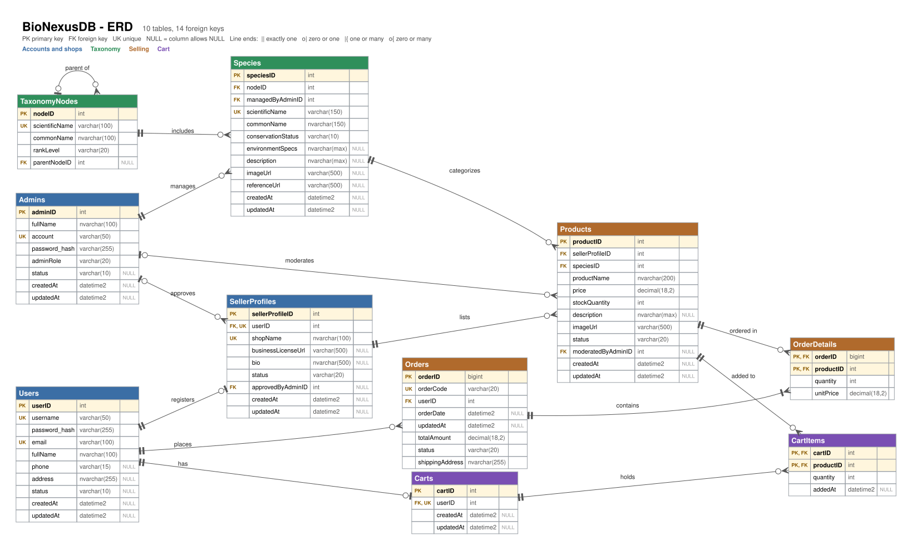
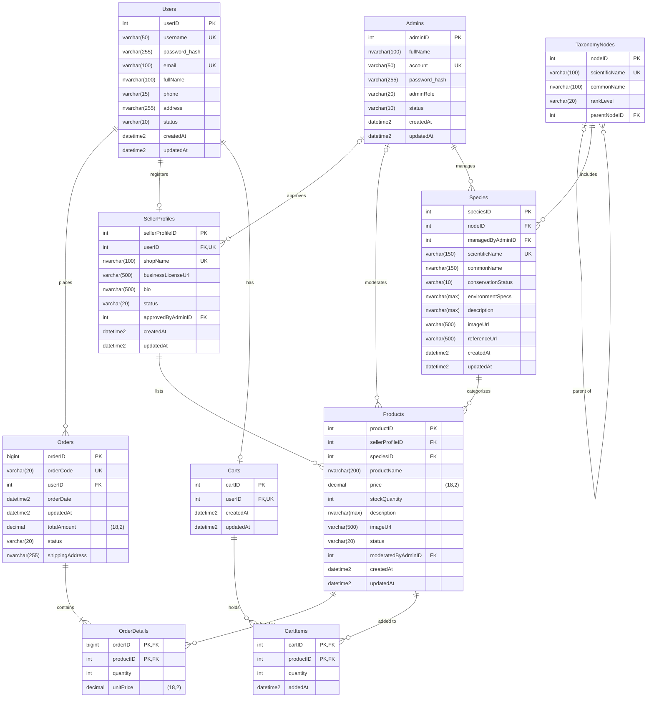

# ERD của BioNexusDB

Sơ đồ quan hệ thực thể của database `BioNexusDB` (SQL Server): **10 bảng, 14 khóa ngoại**. Khớp từng cột với [`database/BioNexusDatabes.sql`](../database/BioNexusDatabes.sql); ảnh và bản chữ bên dưới đều sinh từ metadata của DB đã tạo, và danh sách quan hệ, ràng buộc CHECK đã được đối chiếu tự động với DB.

Bản Chen cũ ([`database/BioNexus.png`](../database/BioNexus.png)) là sơ đồ khái niệm (chỉ có thực thể và quan hệ). Bản này là mức vật lý: có thuộc tính, khóa, bắt buộc/tùy chọn, hai bảng nối N–N (`OrderDetails`, `CartItems`) và giỏ hàng.

Ảnh: [`erd.svg`](erd.svg) (phóng to không vỡ) · [`erd.png`](erd.png).

## 1. Cách đọc

| Ký hiệu | Nghĩa |
|---|---|
| `PK` · `FK` · `UK` | khóa chính · khóa ngoại · giá trị không được trùng (UNIQUE) |
| `NULL` | cột được phép để trống (không ghi thì là `NOT NULL`) |
| `\|\|` hai vạch | đúng 1 |
| `o\|` | 0 hoặc 1 |
| `o{` chân chim và vòng tròn | 0 hoặc nhiều |
| `\|{` chân chim và vạch | 1 hoặc nhiều |

Ký hiệu đứng sát bảng nào cho biết bao nhiêu dòng **của bảng đó** ứng với 1 dòng của bảng kia. Ví dụ `Users ||--o{ Orders`: một đơn thuộc đúng 1 user; một user có 0 hoặc nhiều đơn.

## 2. Bản chữ (Mermaid)

GitHub tự vẽ khối này. Muốn sửa sơ đồ thì sửa chữ ở đây rồi dán vào [mermaid.live](https://mermaid.live).

## 3. Quan hệ (14 khóa ngoại)

| # | Cha | Con | Khóa ngoại | Cha : Con | Ý nghĩa |
|---|---|---|---|---|---|
| 1 | `Users` | `Orders` | `Orders.userID` | 1 : 0..N | Một người dùng đặt nhiều đơn hàng |
| 2 | `Users` | `SellerProfiles` | `SellerProfiles.userID` | 1 : 0..1 | Một người dùng có tối đa 1 shop (`userID` là UNIQUE) |
| 3 | `Users` | `Carts` | `Carts.userID` | 1 : 0..1 | Một người dùng có tối đa 1 giỏ hàng (`userID` là UNIQUE) |
| 4 | `Admins` | `SellerProfiles` | `SellerProfiles.approvedByAdminID` | 0..1 : 0..N | Quản trị viên đã duyệt shop (rỗng khi chưa ai duyệt) |
| 5 | `Admins` | `Products` | `Products.moderatedByAdminID` | 0..1 : 0..N | Quản trị viên đã kiểm duyệt sản phẩm (rỗng khi chưa ai duyệt) |
| 6 | `Admins` | `Species` | `Species.managedByAdminID` | 1 : 0..N | Quản trị viên phụ trách loài |
| 7 | `TaxonomyNodes` | `TaxonomyNodes` | `TaxonomyNodes.parentNodeID` | 0..1 : 0..N | Cây phân loại: nút cha của một nút (rỗng ở nút gốc, tức giới) |
| 8 | `TaxonomyNodes` | `Species` | `Species.nodeID` | 1 : 0..N | Loài thuộc một nút phân loại (theo kế hoạch là nút cấp chi) |
| 9 | `Species` | `Products` | `Products.speciesID` | 1 : 0..N | Sản phẩm thuộc một loài |
| 10 | `SellerProfiles` | `Products` | `Products.sellerProfileID` | 1 : 0..N | Shop đăng bán sản phẩm |
| 11 | `Orders` | `OrderDetails` | `OrderDetails.orderID` | 1 : 1..N | Đơn hàng gồm các dòng chi tiết (≥ 1 dòng do service kiểm, DB không ép) |
| 12 | `Products` | `OrderDetails` | `OrderDetails.productID` | 1 : 0..N | Sản phẩm nằm trong các dòng đơn; đơn giữ giá lúc mua |
| 13 | `Carts` | `CartItems` | `CartItems.cartID` | 1 : 0..N | Giỏ gồm các món (giỏ có thể rỗng) |
| 14 | `Products` | `CartItems` | `CartItems.productID` | 1 : 0..N | Sản phẩm nằm trong các giỏ; giỏ không lưu giá |

"Cha" bắt buộc khi cột khóa ngoại là `NOT NULL` (cột `1`), tùy chọn khi cột cho phép `NULL` (cột `0..1`). "Con" là `0..1` khi khóa ngoại có `UNIQUE`, ngược lại là nhiều.

## 4. Hai bảng nối N–N: dòng đơn và món trong giỏ

Một đơn có nhiều sản phẩm và một sản phẩm nằm trong nhiều đơn (N–N), nên cần bảng ở giữa. Giỏ hàng có cùng hình dạng nhưng vai trò khác:

| | `OrderDetails` (dòng đơn) | `CartItems` (món trong giỏ) |
|---|---|---|
| Nối | `Orders` và `Products` | `Carts` và `Products` |
| Khóa chính | (`orderID`, `productID`): 1 sản phẩm chỉ 1 dòng trong 1 đơn | (`cartID`, `productID`): 1 sản phẩm chỉ 1 dòng trong 1 giỏ |
| Số lượng | `quantity` > 0 | `quantity` > 0 |
| Giá | **Có** `unitPrice`: chụp giá lúc mua, đổi giá sản phẩm về sau không làm đổi đơn cũ | **Không có**: giá luôn đọc từ `Products` lúc hiển thị và lúc đặt hàng |
| Thay đổi sau khi tạo | Không (là lịch sử mua hàng) | Có (thêm, sửa số lượng, xóa món) |
| Tồn kho | Đã trừ khi đặt hàng | Không giữ hàng, chỉ trừ lúc đặt hàng |

## 5. Ràng buộc có sẵn trong DB

**Giá trị cho phép (CHECK)**

| Cột | Giá trị | Mặc định |
|---|---|---|
| `Users.status` | `ACTIVE`, `INACTIVE`, `BANNED` | `ACTIVE` |
| `Admins.status` | `ACTIVE`, `INACTIVE`, `BANNED` | `ACTIVE` |
| `Admins.adminRole` | `MODERATOR`, `BIOLOGIST`, `SUPER_ADMIN` |  |
| `SellerProfiles.status` | `PENDING`, `ACTIVE`, `REJECTED`, `BANNED` | `PENDING` |
| `TaxonomyNodes.rankLevel` | `KINGDOM`, `PHYLUM`, `CLASS`, `ORDER`, `FAMILY`, `GENUS` |  |
| `Species.conservationStatus` | `LC`, `NT`, `VU`, `EN`, `CR`, `EW`, `EX` | `LC` |
| `Products.status` | `PENDING`, `APPROVED`, `REJECTED`, `SOLD_OUT` | `PENDING` |
| `Orders.status` | `PENDING`, `COMPLETED`, `CANCELLED` | `PENDING` |

**Số:** `Products.price` >= 0; `Products.stockQuantity` >= 0; `OrderDetails.quantity` > 0; `OrderDetails.unitPrice` >= 0; `CartItems.quantity` > 0.

**Không được trùng (UNIQUE):** `Users.username`, `Users.email`, `Admins.account`, `SellerProfiles.userID`, `SellerProfiles.shopName`, `TaxonomyNodes.scientificName`, `Species.scientificName`, `Orders.orderCode`, `Carts.userID`.

**Chỉ mục thêm:** `IX_CartItems_productID` trên `CartItems(productID)`. SQL Server không tự đánh chỉ mục cho khóa ngoại; khóa chính (`cartID`, `productID`) đã phục vụ việc tìm theo giỏ, còn tìm theo sản phẩm cần chỉ mục này.

## 6. Luật mà DB không ép (service phải kiểm)

- Đơn phải có ít nhất 1 dòng (`ORDER_EMPTY_ITEMS`); `totalAmount` = tổng `quantity × unitPrice` (DB không kiểm, seed có kiểm).
- Không mua và không bỏ vào giỏ sản phẩm của chính shop mình (`ORDER_OWN_PRODUCT`).
- Chỉ sản phẩm `APPROVED` và còn hàng được bán (`PRODUCT_NOT_AVAILABLE`, `PRODUCT_OUT_OF_STOCK`); tổng số lượng của 1 món trong giỏ không vượt tồn kho (`CART_QUANTITY_EXCEEDS_STOCK`), và phải kiểm lại lúc đặt hàng vì giỏ có thể đã cũ.
- Shop phải `ACTIVE` mới được đăng sản phẩm (`SELLER_NOT_ACTIVE`); đổi trạng thái đúng luồng ở mục 4.3 của [`PLAN.md`](PLAN.md) (`*_INVALID_STATUS_TRANSITION`).
- Loài chỉ gắn vào nút cấp `GENUS`; nút con phải có cấp thấp hơn nút cha (`SPECIES_INVALID_NODE`, `TAXONOMY_INVALID_RANK`): làm nếu còn thời gian.

## 7. Ghi chú thiết kế

- **Không có `ON DELETE CASCADE`.** Xóa dòng cha còn dòng con bị DB chặn (lỗi 547). Dự án đổi trạng thái (`BANNED`, `SOLD_OUT`, `CANCELLED`) thay vì xóa cứng.
- **`createdAt`, `updatedAt`** có mặc định `SYSDATETIME()` lúc tạo; DB không tự cập nhật `updatedAt` khi sửa, câu `UPDATE` phải tự gán (giỏ hàng: `CartsDao.touchCart`).
- **Kiểu dữ liệu:** tiền là `decimal(18,2)` (VND); `Orders.orderID` là `bigint`, các khóa khác là `int`; chữ có dấu dùng `nvarchar`.
- **Giỏ chỉ được tạo khi thêm món đầu tiên** (`CartsDao.getOrCreateCartByUserId`); user chưa mua gì thì chưa có dòng nào trong `Carts`.
